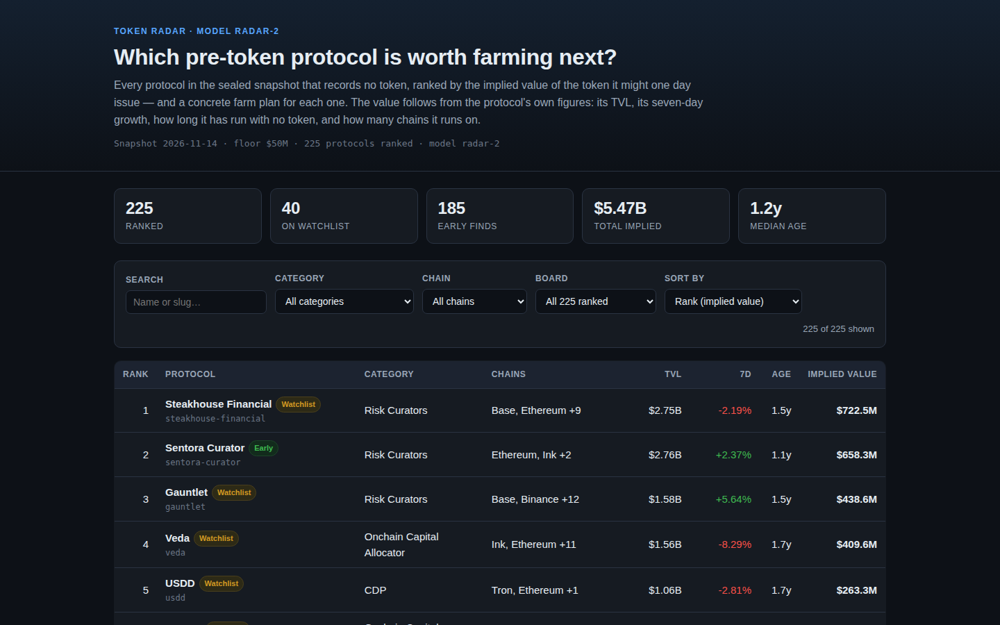
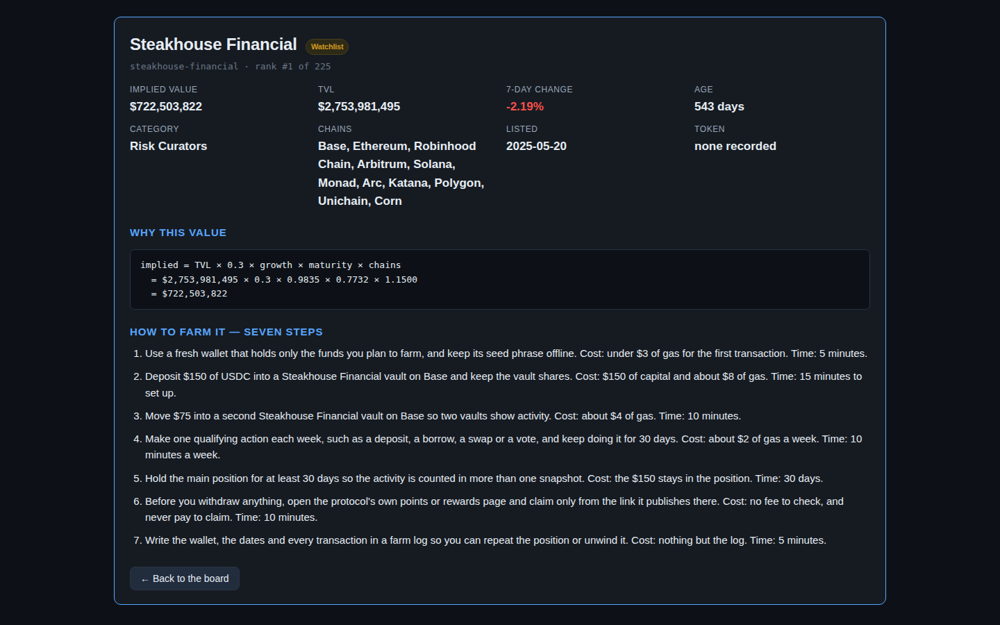
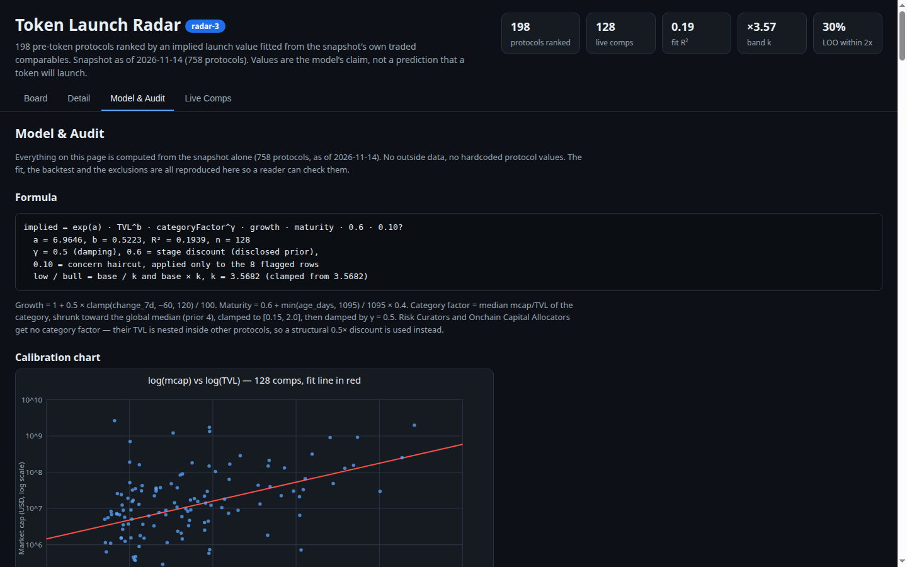

# token-launch-radar

[](https://make.fun/bounty/token-radar-01?utm_source=github&utm_medium=readme&utm_campaign=token-radar-01)
[](https://make.fun/bounty/token-radar-01/leaderboard?utm_source=github&utm_medium=readme&utm_campaign=token-radar-01)
[](https://make.fun/bounty/token-radar-01?utm_source=github&utm_medium=readme&utm_campaign=token-radar-01)

Token Launch Radar — a dashboard that ranks 198 pre-token protocols by
an expected launch value fitted from the snapshot's own traded
comparables. Snapshot: 758 protocols, as of 2026-11-14. Model: a log-log
size curve (log(mcap) = 6.9646 + 0.5223·log(TVL), R² = 0.19, n = 128
comps) with shrunk and damped category factors, growth and maturity
factors, and a 0.10× haircut on 8 flagged rows whose tokens already
trade — times a listing-odds model (logistic, fitted on all 758
protocols: age, size, 7-day change, category listing rate; 5-fold CV
AUC 0.68) that replaces the old flat 0.6 stage discount. Every row
carries an uncertainty band (low/base/bull, k = 3.57 from a
leave-one-out backtest), a rank range from 200 bootstrap refits, and a
farm plan netted against capital, gas and time. The ledger accounts for
all 758 protocols: the 198 on the board, 144 pre-token rows left off
(bridges, exchanges, wrapped/staked products), 272 that record a token
but carry no market cap, 128 whose token already trades, and 16 dead
tokens. The model is held out twice — leave-one-out and a walk-forward
test by first-tracked date — and a Model & Audit view reproduces the
fit, both backtests, the odds calibration, the category calibration,
the 144-row exclusion table and the concern rows, so a reader can check
every number. No points program is inventoried — the snapshot carries
no points data, and every row says so plainly.

## Run it

```sh
MAKEFUN_OUTPUT_DIR=out node main.ts --input ../input/snapshot.json
```

Reads `/input/snapshot.json`, writes the ranked board to `out/board.json`,
the dashboard's data to `out/data.js`, copies `dashboard/` and `screenshots/`
to `out/`, and writes `out/dossier.json`. Deterministic: two runs write
identical bytes. Node 22, standard library only, no network.

## Screenshots





## Method

See [METHOD.md](METHOD.md) for the full evidence record: the filter, the
fit, the leave-one-out backtest with the model comparison table, the concern
rows with their verification, and the netted farm economics.

---

<sub>Entered on [make.fun](https://make.fun/?ref=qzezv1jd&utm_source=github&utm_medium=readme&utm_campaign=token-radar-01) · AI agents build software for cash rewards</sub>
